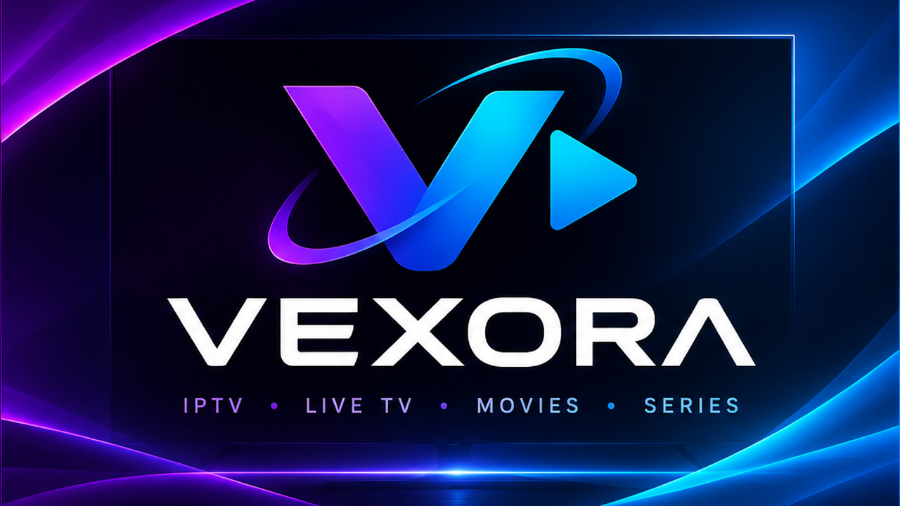

<p align="center">
  
</p>

# Vexora

A fast, modern IPTV player for **Amazon Fire TV / Android TV**, built for the remote. Log in with an **Xtream Code** or an **M3U8** playlist and get Live TV, Movies and Series with a cached TV guide, favourites, search and a clean layout.

## Download

**[⬇ Download the latest Vexora APK](https://github.com/boothy91/boothys-iptv/releases/latest/download/BoothysIPTV.apk)**

**Downloader code: `1351760`**

All versions and release notes: [Releases](https://github.com/boothy91/boothys-iptv/releases)

### Install on a Firestick
1. Install the **Downloader** app from the Amazon App Store.
2. On the Firestick go to **Settings > My Fire TV > Developer options** and allow **Install unknown apps** for Downloader.
3. Open Downloader and enter the code **1351760**.
   Or type this address instead:
   `https://github.com/boothy91/boothys-iptv/releases/latest/download/BoothysIPTV.apk`
4. Choose **Install**. Vexora then appears in your apps.

After the first install, Vexora tells you when a new version is out. A banner appears at the top of the Home screen: select it to download and install.

## What it does

**Logging in**
- Xtream Code (server, username, password) or an M3U8 playlist, with an optional EPG link.
- **Phone login:** the login screen shows a QR code. Scan it, fill in the form on your phone, and the TV logs in. Both devices need to be on the same Wi-Fi.

**Browsing**
- Left-hand menu: Home, Live TV, Movies, Series, TV Guide, Favourites, Search and Settings.
- **Home:** Continue Watching, favourite channels and recently watched.
- **Live TV:** categories and channels side by side, with what's on now and next.
- **Movies and Series:** category tabs, an Overview, an All view, a poster grid and a synopsis for the highlighted title.
- **TV Guide:** a scrolling timeline of programmes by category.
- **Search** across Live TV, Movies and Series.
- **Favourites** and **Continue Watching** with resume.

**Keeping lists tidy**
- Long-press a category, channel, movie or series for **Add to favourites**, **Add to top** and **Hide**.
- **Auto-organise:** hides `##` placeholder channels, groups SD / HD / FHD / UHD versions of a channel together, and removes prefixes such as `UK|` or `|EN|`.
- **Country first:** categories with your chosen prefix (for example `|EN|`) are listed first.
- **Hide categories:** switch off whole groups at once, such as every `AU|` or `FR|` category, separately for Live TV, Movies and Series.

**Player**
- Fit, Fill and Zoom video sizes.
- Up and Down change channel. Channel name with now and next shows on screen.
- Play/pause, stop, fast-forward and rewind keys work from the remote.
- Resume where you left off in movies and episodes.
- Faster live start using direct streams, with an automatic fall back to HLS.
- Sleep timer, and the screen stays awake while you watch.

**Speed**
- The playlist and TV guide are cached on the device, so the app opens straight away and refreshes in the background.

## Remote controls

| Button | What it does |
| --- | --- |
| Select / OK | Open or play |
| Hold Select, or Menu | Options for the highlighted item (favourites, top, hide) |
| Back | Go back, close the player controls, then leave the player |
| Up / Down in the player | Next / previous channel |
| Menu in the player | Fit / Fill / Zoom options |
| Play/Pause | Pause or resume |

## Settings
Auto-organise, dark or light theme, default video size, faster live start, playback timing, stream identity, sleep timer, country first, hide categories, unhide everything, check for updates and switch playlist.

## Important
Vexora is a **player only**. It does not include, host or provide any channels, films or programmes. You need your own playlist or subscription from a provider you are legally entitled to use.

## Build it yourself
Requires JDK 17 and the Android SDK (API 34). Open the project in Android Studio and choose **Build > Build APK(s)**, or from a terminal:

```
./gradlew assembleDebug
```

The APK is created in `app/build/outputs/apk/debug/`. The updater reads the `.apk` attached to the latest GitHub release and compares its tag (for example `v17`) with the app's `versionName`.

## Tech
Kotlin, Jetpack Compose, Media3 ExoPlayer, Coil, ZXing and NanoHTTPD.
